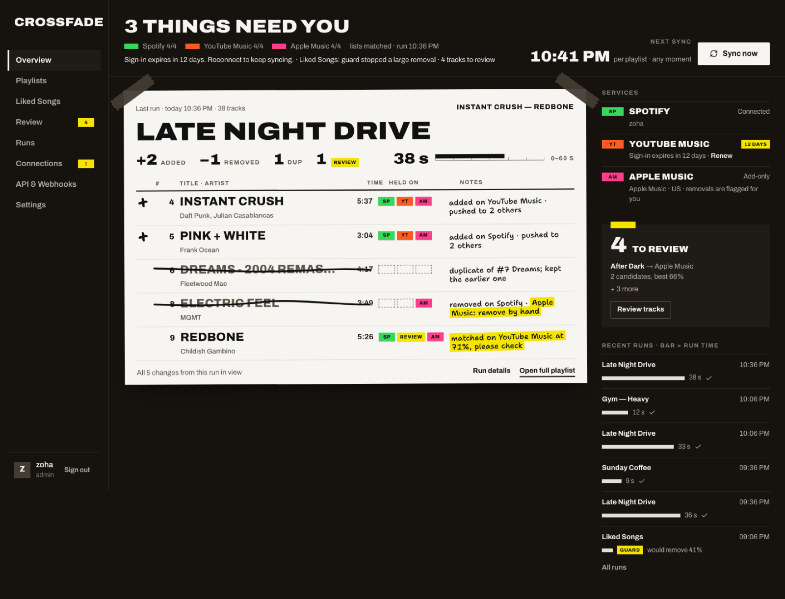

# Crossfade

Keeps your playlists identical on **Spotify**, **YouTube Music** and **Apple Music**, on a schedule, on your own server.

Crossfade holds one clean, deduplicated copy of each playlist (and your liked songs). Every run it reads every linked service, works out what you added or removed since last time, applies that to the clean copy, collapses duplicates, and makes every service match again. Edit a playlist on whichever app you're using today; within one sync the others agree.



<sub>Screenshots use synthetic demo data.</sub>

> **Status: early alpha.** Live-tested with YouTube Music and Apple Music (web session). Spotify is implemented but hasn't been tested against a live account yet. See [docs/PROGRESS.md](docs/PROGRESS.md) for what's verified and what's next.

## What it does

- **Two-way merge.** Adds and removals on any linked service propagate to all the others. If one service removes a track while another adds it in the same cycle, the add wins.
- **Duplicates removed as policy.** Same recording via ISRC, or the same title, artist and version within a few seconds. Remasters fold together; live, acoustic and remix versions never do. Every dedupe is shown, struck through, and can be restored.
- **A deletion guard.** A run that would remove more than 30% of a list (configurable), or a service that suddenly returns an empty playlist, stops and waits for you. Nothing is changed until you look.
- **Match review.** ISRC matching where services expose it; scored title, artist and duration matching where they don't (YouTube Music). Shaky matches still sync but land in Review, one decision at a time with keyboard shortcuts. Paste a link to override any match.
- **Liked songs first.** Spotify *Liked Songs*, YouTube *Liked Music* and Apple *Favorite Songs* sync as one list, and any of them can also be linked to a regular playlist.
- **Preview before writing.** *Create and preview* and *Dry run* show every add and removal per service before anything is written.
- **A REST API, webhooks and exports** so the rest of your homelab can use the clean lists: JSON, CSV, JSPF and M3U.
- **Household accounts.** The first person to open it becomes admin and can add others. Each person links their own accounts. Works behind Authentik, Authelia or any proxy that sets a trusted user header.
- **One container.** One port, one `/data` volume, SQLite, no Redis, no external database.
- **A built-in guide** at `/guide`: how sync works, connecting each service, and how to read a setlist.

## Honest limits

These come from the services, not Crossfade, and the app tells you about them where they matter:

| Service | Limit |
| --- | --- |
| Apple Music | Two ways in. A **web session** (paste the `media-user-token` cookie from music.apple.com) needs no developer account and can remove tracks, but it borrows the web player's access and can break when Apple changes it. A **MusicKit key** (paid Apple Developer Program) is official but **add-only**: removals land in *Review → Remove by hand*. Apple sometimes refuses edits to playlists made in the Music app; those land there too. |
| Spotify | Only playlists you own or collaborate on can be read; Spotify-made playlists (Discover Weekly etc.) are blocked for developer apps. A developer-mode app allows **5 users** and its owner needs **Premium**. Sign-ins expire after **6 months**; Crossfade warns two weeks ahead. |
| YouTube Music | No official music API. Crossfade uses your browser's session cookie via [YouTube.js](https://github.com/LuanRT/YouTube.js); YouTube can expire it without warning. No ISRC codes, so matches rely on title, artist and length. |

## Quick start

```yaml
# docker-compose.yml
services:
  crossfade:
    image: ghcr.io/ahamedzoha/crossfade:latest
    restart: unless-stopped
    ports:
      - "8080:8080"
    environment:
      APP_URL: "https://crossfade.example.com" # the address you open it at
      TZ: "Europe/London"
    volumes:
      - ./data:/data
```

```sh
docker compose up -d
```

Open the address, create the admin account, then:

1. **Settings → Service apps**: add your Spotify app and, if you use it, your Apple MusicKit key (guides below).
2. **Connections**: link your accounts.
3. **Playlists → New playlist**: pick the playlist on each service that should match. Or let Crossfade create the copies.
4. Optionally **Liked Songs**.

### HTTPS matters

Spotify only redirects back to `https://` addresses or `http://127.0.0.1`. Put Crossfade behind your reverse proxy (Nginx Proxy Manager, Traefik, Caddy) with a certificate and set `APP_URL` to that address. Apple's sign-in also expects HTTPS.

On plain HTTP over a LAN IP, Spotify still works through a copy-paste step: you approve on Spotify, land on a page that fails to load at `http://127.0.0.1:8888/callback?code=…`, and paste that address back into Crossfade.

## Configuration

Everything has a default. Provider credentials can be entered in the UI (stored encrypted) or set here.

| Variable | Default | |
| --- | --- | --- |
| `APP_URL` | `http://localhost:8080` | Public address. Used for OAuth redirects and API examples. |
| `PORT` | `8080` | Port the container listens on. |
| `DATA_DIR` | `/data` | SQLite database and the generated encryption key. |
| `PUID` / `PGID` | `1000` | Owner of the data volume. The container drops to this user. |
| `TZ` | `UTC` | Time zone for logs. |
| `SECRET_KEY` | generated | Encrypts provider sign-ins at rest. If unset, one is generated into `/data/.secret-key`. Back it up with the database. |
| `TRUSTED_HEADER` | – | e.g. `Remote-User`. Signs people in from a header your auth proxy sets, creating accounts on first sight. **Only enable if the port is reachable solely through that proxy**, or anyone can forge the header. |
| `SPOTIFY_CLIENT_ID`, `SPOTIFY_CLIENT_SECRET` | – | Instead of Settings. |
| `APPLE_TEAM_ID`, `APPLE_KEY_ID`, `APPLE_PRIVATE_KEY` | – | Instead of Settings. `APPLE_PRIVATE_KEY_FILE` reads the `.p8` from a file (Docker secrets); `SECRET_KEY`, the Spotify and Apple variables all accept a `_FILE` suffix. |
| `WORKER_CONCURRENCY` | `2` | Playlists synced in parallel. |
| `LOG_LEVEL` | `log` | `error`, `warn`, `log`, `debug`, `verbose`. |

The API listens on `127.0.0.1:4000` inside the container; that port is internal and isn't published.

## Setting up the services

### Spotify

1. Go to [developer.spotify.com/dashboard](https://developer.spotify.com/dashboard) and create an app with the Web API.
2. Add the redirect URI shown in **Settings → Service apps** (it's `APP_URL` + `/api/connections/spotify/callback`).
3. Under **User Management**, add the Spotify email of everyone who'll connect (up to 5).
4. Paste the client ID and secret into Settings.

### Apple Music

**Web session (no developer account).** Each person signs in at music.apple.com, opens developer tools → Storage (Application in Chrome) → Cookies → `https://music.apple.com`, copies the `media-user-token` value and pastes it under **Connections → Apple Music → Connect with a web session**. It lasts about six months. Unofficial: Crossfade reads the web player's own access token from music.apple.com, so an Apple redesign can break it until Crossfade is updated.

**MusicKit key (official, add-only).**

1. In your Apple Developer account: **Certificates, Identifiers & Profiles → Keys**, create a key with **MusicKit** enabled and download the `.p8` (downloadable once).
2. Paste your Team ID, the key ID and the `.p8` contents into Settings.
3. Each person connects under **Connections → Use a MusicKit key**; Apple opens a sign-in window.

### YouTube Music

Nothing to set up on the server. Each person:

1. Opens `music.youtube.com` in a private window and signs in.
2. Opens developer tools → Network, clicks a request to `youtubei/v1/…`, and copies the **Cookie** request header.
3. Pastes it under **Connections**, then closes the private window without signing out (signing out kills the cookie).

## How a sync works

For one playlist:

1. **Pull.** Read the playlist from every linked service and map each track to a canonical track (known id → ISRC → normalised title/artist/version → new).
2. **Diff.** Compare each service with what it held after the last sync. New ids are adds; missing ids are removals. A first link is a pure merge.
3. **Guard.** Too many removals, or a service returning nothing, stops the run.
4. **Apply** adds (they win) and removals to the canonical list, then **dedupe**.
5. **Push.** Find each canonical track on every service (ISRC first, then scored search), add what's missing, remove what shouldn't be there. Low-confidence matches sync and go to Review; no match goes to Review without syncing. Apple removals with a MusicKit key become to-dos. Each run makes at most 150 new searches per service and pauses a service that rate-limits, so a large first merge completes over a few scheduled runs.
6. **Snapshot** each service so the next run only sees what people changed.

Links can be **Two-way**, **Read only** (Crossfade never writes to it) or **Mirror** (made to match exactly). **Dry run** shows what a sync would do without writing anything.

## API

Create a key under **API & Webhooks** and send it as `Authorization: Bearer cf_…`. Read keys can call `GET`; write keys can also trigger syncs and edit playlists.

```sh
curl -H "Authorization: Bearer $CROSSFADE_KEY" https://crossfade.example.com/api/v1/playlists
curl -H "Authorization: Bearer $CROSSFADE_KEY" https://crossfade.example.com/api/v1/playlists/pl_…/export?format=jspf
curl -X POST -H "Authorization: Bearer $CROSSFADE_KEY" https://crossfade.example.com/api/v1/sync
```

The OpenAPI 3.1 document is at `/api/openapi.json`; the app's **API & Webhooks** page has the full reference.

**Webhooks** POST JSON for `run.finished`, `run.failed`, `run.guarded`, `playlist.changed`, `review.created` and `connection.expired`, signed with `X-Crossfade-Signature: sha256=<hmac of the raw body>`, retried up to five times.

## Backups

Everything lives in the `/data` volume: `crossfade.db` (SQLite, WAL mode) and `.secret-key`. Back up the whole directory. Without the key, stored sign-ins can't be decrypted and everyone has to reconnect; playlists and history survive.

## Development

Requires Node 24 and pnpm 11.

```sh
pnpm install
cp .env.example .env
pnpm dev            # API on :4000 (with worker), web on :3000
pnpm test           # matching + sync engine scenarios
pnpm build
```

Try the UI with synthetic data and no real accounts:

```sh
pnpm --filter @crossfade/api build
DATA_DIR=./demo-data pnpm --filter @crossfade/api demo:seed
DATA_DIR=./demo-data WORKER_DISABLED=1 pnpm --filter @crossfade/api start   # sign in as demo / crossfade-demo
pnpm --filter @crossfade/web dev
```

### Layout

```
apps/api        NestJS: REST API, auth, sync engine, SQLite job queue, scheduler, providers
apps/web        Next.js App Router frontend (talks to the API through /api)
packages/shared Types, provider metadata and request schemas used by both
docker/         Entrypoint and process supervisor for the single-image build
```

Database migrations live in `apps/api/drizzle` and run on start. After changing `apps/api/src/db/schema.ts`, run `pnpm db:generate`.

## License

MIT
